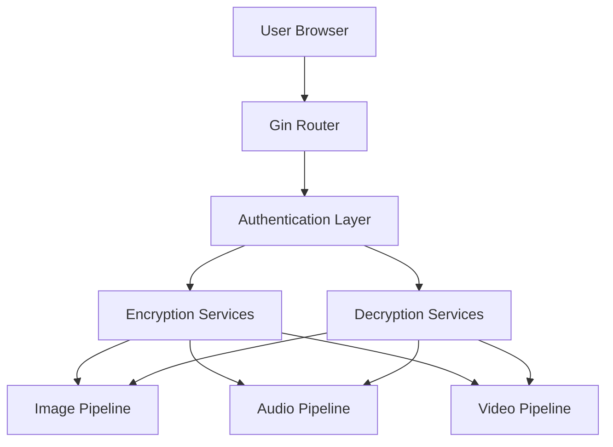

# KRYPTO 

KRYPTO is a secure multimedia encryption platform built with Go and Gin. The application allows users to encrypt and decrypt images, audio, and video files through a simple web interface.

The project combines AES-based cryptography, user authentication, media processing, and a lightweight HTML frontend.

---

## Features

- User Registration & Login
- Media Encryption & Decryption
- Image Protection
- Audio Protection
- Video Protection
- Secure Authentication Middleware
- SQLite Database Integration
- Clean Web Interface
- Go + Gin Backend

---
## Tech Stack

### Backend
- Go
- Gin Framework
- SQLite
- AES Encryption

### Frontend
- HTML5
- CSS3

### Tools
- FFmpeg (Video Processing)
- Git
- Docker (Optional)

---

## Project Structure

```text
KRYPTO/
│
├── Backend/
│   ├── auth.go
│   ├── config.go
│   ├── db.go
│   ├── encryptimage.go
│   ├── decryptimage.go
│   ├── encryptaudio.go
│   ├── decryptaudio.go
│   ├── encryptvideo.go
│   ├── decryptvideo.go
│   └── main.go
│
├── Frontend/
│   ├── home.html
│   ├── login.html
│   ├── signup.html
│   ├── encrypt.html
│   ├── decrypt.html
│   ├── encryptimage.html
│   ├── decryptimage.html
│   ├── encryptaudio.html
│   ├── decryptaudio.html
│   ├── encryptvideo.html
│   └── decryptvideo.html
│
├── krypto.db
├── go.mod
└── README.md
```

---

## Architecture



---

## Installation

### Clone Repository

```bash
git clone https://github.com/gurumdlrdev-hub/Krypto.git
cd Krypto
```

### Install Dependencies

```bash
go mod tidy
```

### Run Application

```bash
go run Backend/main.go
```

### Open Browser

```text
http://localhost:2409
```

---

## Supported Operations

| Media Type | Encrypt | Decrypt |
|------------|---------|----------|
| Image | ✅ | ✅ |
| Audio | ✅ | ✅ |
| Video | ✅ | ✅ |

---

## Screenshots

### Home Page

https://res.cloudinary.com/ygllvtyg/image/upload/v1793043078/Screenshot_2026-10-27_005805_n46vzl.png

### Login Page

https://res.cloudinary.com/ygllvtyg/image/upload/v1793043054/Screenshot_2026-10-27_005744_klkdgd.png

### Image Encryption

https://res.cloudinary.com/ygllvtyg/image/upload/v1793043084/Screenshot_2026-10-27_005832_o91vvx.png

## Audio Encryption

https://res.cloudinary.com/ygllvtyg/image/upload/v1793043088/Screenshot_2026-10-27_005904_afyhv2.png

### Video Encryption

https://res.cloudinary.com/ygllvtyg/image/upload/v1793043067/Screenshot_2026-10-27_005928_dhvnft.png

---

## Learning Outcomes

This project helped me learn:

- Go Backend Development
- Gin Framework
- Authentication Systems
- Database Integration
- Cryptography Fundamentals
- Multimedia Processing
- File Handling
- Project Architecture

---

## Future Improvements

- JWT/PASETO Authentication
- Role-Based Access Control
- Cloud Storage Support
- File Encryption Progress Tracking
- Docker Compose Deployment
- REST API Documentation

---

## Author

**Guru Mudhaliyar**

GitHub:
https://github.com/gurumdlrdev-hub

---

## License

MIT License

Architecture Diagram
## System Architecture

```mermaid
flowchart TD
    Client["Client (Web Browser)"] -->|HTTP / Multipart Form Data| Router["Gin HTTP Router (:2409)"]
    Router --> Auth["PASETO Authentication Middleware"]

    %% Flow Split
    Auth -->|/encrypt/*| EncryptPipeline["Encrypt Engine"]
    Auth -->|/decrypt/*| DecryptPipeline["Decrypt Engine"]

    %% Encryption Flow
    subgraph Encryption ["Encryption Pipeline"]
        EncryptPipeline --> EncImgAud["Image / Audio Pipeline"]
        EncryptPipeline --> EncVid["Video Pipeline"]

        EncImgAud --> ReadRaw["Read Raw Binary Bytes"]
        ReadRaw --> AESEnc1["AES-256-GCM Encryption<br/>(Nonce Prepended + Auth Tag)"]
        AESEnc1 --> OutEnc[".enc Ciphertext Stream Download"]

        EncVid --> SplitVid["Frame Decomposition (30 FPS)<br/>+ Audio Stream Extraction"]
        SplitVid --> ReadFrames["Read Frame & Audio Bytes"]
        ReadFrames --> AESEnc2["AES-256-GCM Encryption"]
        AESEnc2 --> ZipArchive["Archive Encrypted Frames & Audio"]
        ZipArchive --> OutZip[".zip Archive Stream Download"]
    end

    %% Decryption Flow
    subgraph Decryption ["Decryption Pipeline"]
        DecryptPipeline --> DecImgAud["Image / Audio Pipeline"]
        DecryptPipeline --> DecVid["Video Pipeline"]

        DecImgAud --> ReadEnc["Parse .enc Stream<br/>(Extract 12-byte Nonce)"]
        ReadEnc --> AESDec1["AES-256-GCM Decryption<br/>(Tag Verification)"]
        AESDec1 --> OutMedia["Restored Media Stream<br/>(.png / .wav / .mp3)"]

        DecVid --> Unzip["Extract .zip Archive"]
        Unzip --> AESDec2["AES-256-GCM Decryption<br/>(Frames & Audio)"]
        AESDec2 --> StitchVid["Reassemble Frames (30 FPS)<br/>+ Merge Audio Track"]
        StitchVid --> OutMP4["Restored Video Stream (.mp4)"]
    end

    %% Egress
    OutEnc --> Client
    OutZip --> Client
    OutMedia --> Client
    OutMP4 --> Client
